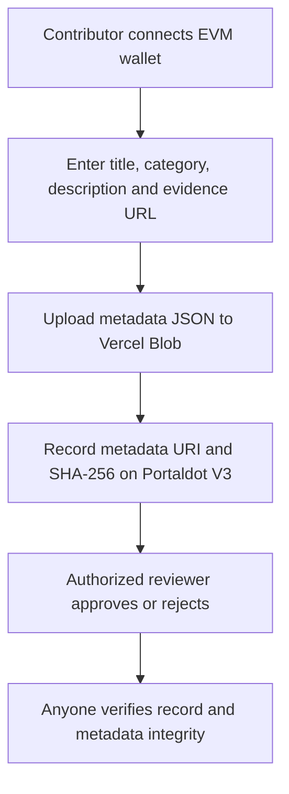

# PoC Ledger — Proof of Contribution

**One Action. One Proof. Verifiable on Portaldot V3.**

PoC Ledger is a Web3 application for recording, reviewing, and independently verifying community contributions. It combines an on-chain EVM contribution registry with external JSON metadata whose integrity is anchored by SHA-256.

Built for **Portaldot Hacker House 2026 — Track 4: Ecosystem DApps**.

- **Live DApp:** https://pocledger.xyz/
- **Source code:** https://github.com/Qnam309/proof-of-contribution
- **Network:** Portaldot V3 Testnet (EVM chain ID `420420777`)
- **Deployed ContributionRegistry:** `0x2719e83b13f737a4f3988b7e13ef028e93bb1cb2`

> **Status:** Deployed testnet MVP. The primary EVM submission, approval, and verification flow has been tested with a real contribution. This is not a mainnet production service.

## The problem

Open-source work, tutorials, translations, research, and community support are frequently documented in disconnected channels. Communities need a way to attribute a contribution, review it, and let others check that the published record matches what was registered.

## How PoC Ledger works



The EVM contract stores a reference to the off-chain metadata and a cryptographic commitment rather than the complete JSON description. Verification fetches that metadata, independently computes its hash, compares it to the on-chain record, and checks the contribution's approval status through the contract.

**Verification of a matching hash does not prove the underlying contribution is genuine or high quality**; that judgment remains part of the review process.

## Features

| Module | What it does |
| --- | --- |
| Wallet connection | Connects MetaMask and OKX Wallet; requests switching to or adding Portaldot V3 Testnet when needed |
| Submit | Records a contribution on the deployed EVM registry after uploading JSON metadata |
| Review | Authorized reviewer wallets approve or reject pending submissions through on-chain transactions |
| My Proofs / Explore | Reads EVM contribution records and their statuses from the testnet |
| Verify — EVM Registry | Independently compares evidence SHA-256 and checks approved state using the EVM contract; read-only |
| Verify — Native Proof | Separate flow for legacy/native Portaldot proof records |
| Verify — Local Demo | Browser-based demonstration, not an on-chain attestation |
| Admin Panel | Contract admin grants and revokes reviewer permissions; keeps a locally tracked history of previously seen reviewers |
| Share | Provides links to inspect individual proofs |

**Important:** The Admin Panel's tracked reviewer list is **not** a complete chain-wide index of all authorized reviewers. Permissions are checked on-chain. The browser demo uses local data and must not be mistaken for the EVM registry.

## Verified V3 EVM test

A live end-to-end flow was tested with **Contribution #2**:

- **Title:** PoC Ledger Wallet Integration Testing
- **Category:** Development
- **Evidence:** https://github.com/Qnam309/proof-of-contribution
- **Outcome:** Submitted → Approved by an authorized reviewer → independently Verified
- **Verification result:** `VERIFIED: APPROVED ON-CHAIN`
- **Metadata integrity:** SHA-256 of the fetched external JSON matched the stored on-chain hash
- **Approval block:** `267296`
- **Approval transaction:** `0x73c1b001158e5d7de095487ec7504b58d4c665a7fd7189fe6e3a34acce379d32`

To reproduce the read-only verification, open **Verify → EVM Registry**, enter Contribution ID `2`, and click **Verify EVM Record (free)**. This does not require a wallet or testnet tokens, but it does depend on the network/RPC being available.

### Earlier native proof experiment

The earlier native path published and verified a proof using `system.remarkWithEvent` (block `137579`, extrinsic index `1`, transaction `0x8e84f3871cf90ec6c98d87842ee46f618f4b86c37bbaf38a16e48c658394b27d`). This is a **separate** flow from the current EVM `ContributionRegistry`, and should not be confused with the EVM Contribution #2.

## Architecture and technology

- **Frontend:** React, Vite, JavaScript, CSS
- **Blockchain:** Portaldot V3 Testnet, EVM smart contract `ContributionRegistry`
- **Wallets:** MetaMask and OKX Wallet for EVM; Portaldot-compatible wallet for the separate native functionality
- **Metadata:** Vercel Blob for JSON storage; SHA-256 for integrity checks
- **Backend:** Vercel Serverless Functions, with wallet-authorization checks for uploads
- **Rate limiting:** Upstash Redis in the opt-in community upload mode
- **Hosting:** Vercel

### EVM network

| Field | Value |
| --- | --- |
| Network name | Portaldot V3 Testnet |
| Chain ID | `420420777` |
| RPC | `https://test-evm-rpc-v3.portaldot.dev` |
| Currency | POT (testnet tPOT) |
| Explorer | https://scanner-testnet-v3.portaldot.dev/ |

Testnet outages or slow RPC responses can delay transaction confirmation and the loading of on-chain records.

## Run locally

Requirements: Node.js, npm, and an EVM wallet extension for transaction-writing operations.

```bash
git clone https://github.com/Qnam309/proof-of-contribution.git
cd proof-of-contribution
npm install
```

For frontend-only development:

```bash
npm run dev
```

For complete local testing, including the `/api` serverless endpoints used for metadata upload:

```bash
npx vercel dev
```

Follow the local URL printed by the selected command. `npm run dev` alone does **not** provide the Vercel API endpoints required by the full Submit flow.

### Server-side configuration

Use Vercel project environment variables (and the local development configuration pulled by Vercel CLI) for the required Blob/authentication settings. The upload API supports a restricted allowlist mode and an opt-in public/community mode. Consult [`UPLOAD_MODES.md`](./UPLOAD_MODES.md) for the exact settings and deployment precautions.

Never commit `.env.local`, `.vercel/`, private keys, Blob credentials, Redis credentials, or other secrets. Public/community upload requires server-side safeguards; **do not disable the allowlist without enabling and testing the configured protection**.

## What costs testnet POT?

| Action | Requires tPOT? |
| --- | --- |
| Browse records, verify EVM proof | No |
| Connect wallet | No |
| Submit contribution | Yes — contributor wallet |
| Approve or reject | Yes — authorized reviewer wallet |
| Grant or revoke reviewer | Yes — contract admin wallet |

Gas estimates shown before sending a transaction are not necessarily final fees. Check the wallet confirmation carefully. The native-wallet testnet token distribution process is separate from EVM wallet connection.

## Scope and roadmap

**Implemented and tested:** EVM wallet connectivity, on-chain submissions, Vercel Blob metadata integrity checks, reviewer decisions, read-only verification, and on-chain reviewer administration.

**Remaining work before broad public use:** Verify Production environment variables and community upload limits, review backend security and abuse protections, improve RPC outage handling, and run broader multi-wallet tests. Potential later improvements include contributor reputation, richer indexing, and sponsored gas for newcomers.

The repository also contains testing utilities. These should not be treated as production payment/transfer services.

---

**Built for Portaldot Hacker House 2026.**
