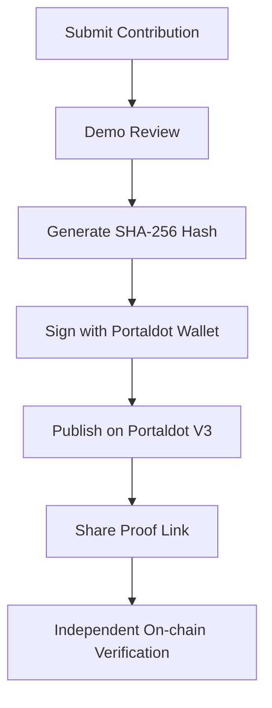

# Proof of Contribution (PoC)

**One Action. One Proof. Two Applications.**

A Web3 application that helps communities record, share, and independently verify contribution proofs on **Portaldot V3 Testnet**.

Built for **Portaldot Hacker House 2026 — Track 4: Ecosystem DApps**.

**Live Demo:** https://pocledger.xyz  
**GitHub:** https://github.com/Qnam309/proof-of-contribution

---

## Why Proof of Contribution?

Web3 communities thrive on contributions: tutorials, research, translations, open-source tools, and educational content.

But these contributions are often scattered across Discord servers, spreadsheets, and community platforms.

**Proof of Contribution (PoC)** explores a simple way to turn contribution records into portable, blockchain-verifiable proofs.

**Submit → Review → Publish → Share → Verify**

## Key Features

### 1. Submit Contributions
Contributors can submit their work with a title, category, description, and evidence URL.

### 2. Review Workflow
A simple interface demonstrates how contributions can be approved or rejected before publication.

### 3. Publish On-chain
Approved demo records can be hashed with **SHA-256** and published to Portaldot V3 Testnet using `system.remarkWithEvent`.

### 4. Independent Verification
Anyone can verify a published proof directly against blockchain data, including its transaction, proof hash, and execution status.

**No wallet connection is required to verify an existing proof.**

### 5. Shareable Proofs
Generate a verification link that others can open to inspect the corresponding blockchain proof.

### 6. Dashboard & Network
View contribution activity, manage locally saved proofs, and explore live Portaldot V3 network information.

## How It Works



The application uses a Portaldot-compatible wallet to sign blockchain transactions and a live RPC connection to verify published proofs.

## Verified Testnet Transaction

The MVP has successfully published and independently verified a real proof on **Portaldot V3 Testnet**.

| Detail | Value |
|---|---|
| Contribution | Portaldot V3 Beginner Guide |
| Block | `137579` |
| Extrinsic Index | `1` |
| Transaction | `system.remarkWithEvent` |
| Result | ON-CHAIN VERIFIED |

**Transaction Hash:**

`0x8e84f3871cf90ec6c98d87842ee46f618f4b86c37bbaf38a16e48c658394b27d`

**Proof Hash:**

`0x20ffba48d931940219c5ad726f2dac0487efbd6cd8d197396461a0411b56f116`

Try the example proof through the **Verify** interface at https://pocledger.xyz.

## Tech Stack

- **Frontend:** React, Vite, JavaScript, CSS
- **Blockchain:** Portaldot V3 Testnet
- **Wallet:** Portaldot Wallet extension
- **Blockchain API:** `@polkadot/api`
- **Proof Hashing:** SHA-256
- **Hosting:** Vercel

**Native RPC:** `wss://test-node-v3.portaldot.dev`

## Run Locally

Requirements: Node.js, npm, and a Portaldot-compatible browser wallet for signing transactions.

```bash
git clone https://github.com/Qnam309/proof-of-contribution.git
cd proof-of-contribution
npm install
npm run dev
```

Open the local URL shown in your terminal.

## Current Status & Roadmap

**Working MVP:** Contribution submission, demo review, wallet connection, real on-chain proof publication, independent verification, shareable proof links, and network information.

**Current limitations:** Submissions, reviewer decisions, and dashboard statistics use browser `localStorage`. They are not synchronized across devices, and reviewer permissions are not enforced on-chain.

**Important:** An on-chain proof confirms that a hash was published in a successful blockchain transaction. It does not independently establish the authenticity or quality of the underlying contribution.

**Next steps:** On-chain reviewer authorization, persistent contribution records, and improved cross-community verification.

---

**Built for Portaldot Hacker House 2026.**