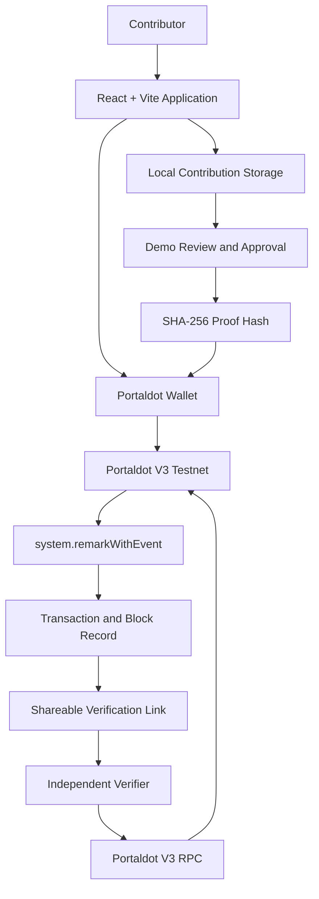
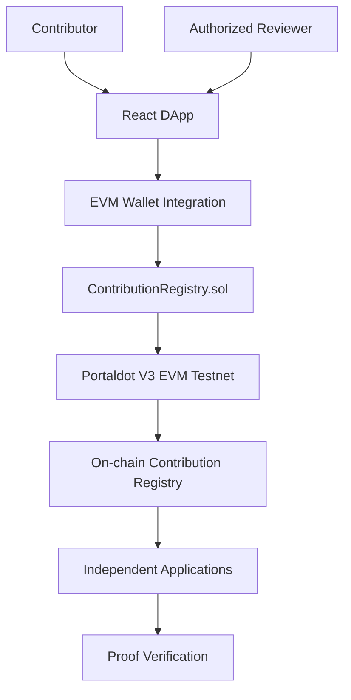

# Proof of Contribution (PoC)

**One Action. One Proof. Two Applications.**

A Web3 application for recording, publishing, sharing, and independently verifying community contributions on **Portaldot V3 Testnet**.

Built for **Portaldot Hacker House 2026 — Track 4: Ecosystem DApps**.

**Live Application:** https://pocledger.xyz

**GitHub Repository:** https://github.com/Qnam309/proof-of-contribution

**Project Status:** Working Testnet MVP + Solidity Smart Contract Prototype

---

## 1. Overview

Proof of Contribution (PoC) explores a simple idea:

**Meaningful community contributions should be supported by evidence that others can independently verify.**

Web3 contributors create tutorials, educational resources, open-source tools, research articles, translations, and community content.

However, recognition often remains fragmented across Discord servers, spreadsheets, leaderboards, and individual platforms.

Proof of Contribution introduces a workflow to turn contribution data into cryptographic proof records published on Portaldot V3.

**Submit → Review → Publish → Share → Verify**

The long-term vision is to make contribution records portable across Web3 communities and applications.

### MVP Status

The current deployed MVP includes real Portaldot V3 blockchain interactions.

**Working on-chain features:**
- Connect a Portaldot wallet.
- Generate a SHA-256 contribution hash.
- Publish the hash using `system.remarkWithEvent`.
- Verify transaction inclusion and execution.
- Share proof verification links.
- Verify an existing proof without connecting a wallet.

**Current demonstration features:**
- Contribution submissions stored in browser `localStorage`.
- Reviewer approval and rejection stored locally.
- Contribution statistics derived from locally stored records.

The deployed MVP does not yet enforce reviewer authorization on-chain. Blockchain verification confirms publication of a hash, not the authenticity or quality of the underlying contribution.

---

## 2. The Problem

Web3 communities depend on active contributors, but contribution recognition faces several challenges.

### Fragmented Records

Achievements are often stored across different platforms, making it difficult to maintain a consistent contribution history.

### Limited Independent Verification

Screenshots, XP points, Discord roles, and manual records may be difficult for external communities to validate.

### Poor Portability

A contributor recognized in one community may have to rebuild their reputation when joining another.

### Lack of Standardized Proof

Communities need practical ways to reference and verify published contribution evidence.

---

## 3. Our Solution

Proof of Contribution provides a workflow connecting contribution evidence with verifiable blockchain records.

### Step 1 — Submit Contribution

A contributor connects a Portaldot Wallet and submits:

- Contribution title
- Category
- Description
- Evidence URL
- Contributor wallet address

The current MVP stores this information locally in the browser.

### Step 2 — Review & Approve

A reviewer examines the submitted evidence and makes an approval or rejection decision.

The deployed application currently demonstrates this process using local reviewer controls.

These controls are not protected by on-chain reviewer authorization.

### Step 3 — Publish Proof On-chain

For an approved local contribution, the application creates a SHA-256 hash from a JSON representation of selected contribution fields.

The user signs a `system.remarkWithEvent` transaction through the Portaldot Wallet extension.

The transaction publishes the resulting hash to Portaldot V3 Testnet.

### Step 4 — Share Proof

After publication, the user can generate a shareable verification link containing references to:

- Transaction hash
- Proof hash
- Block number or block hash

The link can be opened by another person or application.

### Step 5 — Verify On-chain

The verifier connects directly to the Portaldot V3 node and checks:

1. The specified blockchain block.
2. Transaction inclusion.
3. The `system.remarkWithEvent` call.
4. The published proof hash.
5. Successful execution events.
6. The corresponding blockchain record.

A successful result confirms that the supplied hash was published through a successful transaction.

It does not independently certify the submitted work or establish that a trusted reviewer approved it.

---

## 4. Key Features

### Landing Page & Launch App

A public landing page introduces the project and provides access to the application.

### Dashboard

A Web3 workspace with contribution statistics, recent activity, and quick navigation.

### Portaldot Wallet Connection

Connects to the Portaldot browser wallet using the native injected wallet interface.

### Submit Contribution

Allows contributors to submit a title, category, description, and evidence URL.

### Review & Approve

Demonstrates contribution review, approval, and rejection workflows.

### My Proofs

Displays locally saved contributions and their available on-chain publication information.

### Publish Proof On-chain

Publishes contribution hashes through real Portaldot V3 Testnet transactions.

### Shareable Proof

Creates shareable links that allow other users to check blockchain proofs independently.

### Verify On-chain

Checks proof publication using actual blockchain data, without requiring the verifier to connect a wallet.

### Explore Proofs

Provides a public interface to explore available example proofs and access verification.

The current public gallery is not a complete blockchain-wide contribution index.

### Live Network Status

Reads blockchain information through the Portaldot V3 WebSocket RPC, including chain information, a recent block number, and connected account balances.

---

## 5. Architecture

### Current Deployed MVP



### Current System Components

| Component | Technology |
|---|---|
| Frontend | React + Vite |
| Programming Language | JavaScript |
| UI | CSS + Lucide React |
| Native Blockchain API | `@polkadot/api` |
| Wallet | Portaldot Wallet Extension |
| Blockchain | Portaldot V3 Testnet |
| Proof Hashing | SHA-256 |
| Native Proof Publication | `system.remarkWithEvent` |
| Local Demo Storage | Browser `localStorage` |
| Hosting | Vercel |
| Version Control | GitHub |

**Native RPC:**

`wss://test-node-v3.portaldot.dev`

---

## 6. Verified Portaldot V3 Testnet Proof

The application successfully published and independently verified a contribution proof on Portaldot V3 Testnet.

### Transaction Details

| Field | Value |
|---|---|
| Contribution | Portaldot V3 Beginner Guide |
| Network | PortaldotV3 Test |
| Block Number | `137579` |
| Extrinsic Index | `1` |
| Transaction Type | `system.remarkWithEvent` |
| Verification Result | ON-CHAIN VERIFIED |

**Transaction Hash:**

`0x8e84f3871cf90ec6c98d87842ee46f618f4b86c37bbaf38a16e48c658394b27d`

**Proof Hash:**

`0x20ffba48d931940219c5ad726f2dac0487efbd6cd8d197396461a0411b56f116`

The verifier successfully located the transaction, matched the proof hash, and confirmed the relevant success events.

**Important:** This demonstrates blockchain inclusion and successful execution, not independent certification of the underlying contribution.

Visitors can test the public sample proof through the Verify interface.

---

## 7. Solidity Smart Contract — ContributionRegistry

In addition to the deployed native-chain MVP, the repository includes a Solidity smart contract prototype.

**Contract source:**

`contract-kit/contracts/ContributionRegistry.sol`

The contract is designed to introduce on-chain contribution management and reviewer authorization.

### Contract Functions

| Function | Purpose |
|---|---|
| `submitContribution()` | Register a contribution hash and supporting metadata |
| `setReviewer()` | Grant or revoke reviewer permissions |
| `approveContribution()` | Approve a contribution using an authorized reviewer |
| `rejectContribution()` | Reject a contribution using an authorized reviewer |
| `verifyContribution()` | Check the contribution's approval state and matching proof |
| `getContribution()` | Retrieve stored contribution information |

### Contract Security Rules

The implementation includes checks designed to:

- Reject empty contribution hashes.
- Validate evidence URL input.
- Prevent duplicate submissions of the same hash from the same contributor.
- Restrict reviewer management to the administrator.
- Prevent unauthorized reviews.
- Prevent self-review, including when a contributor also has reviewer privileges.
- Prevent double review or modification of an already reviewed contribution.
- Prevent revoked reviewers from performing review operations.
- Reject invalid contribution lookups and review actions.

### Local Smart Contract Testing

**Framework:** Hardhat 3

**Confirmed local test result: 13 passing, 0 failing.**

The automated tests cover:

- Administrator initialization.
- Contribution submission and metadata.
- Input validation.
- Duplicate contribution prevention.
- Reviewer authorization management.
- Unauthorized review rejection.
- Self-review prevention.
- Approved contribution verification.
- Incorrect proof rejection.
- Duplicate review prevention.
- Invalid contribution handling.
- Reviewer revocation.

### Run Contract Tests

From the project root:

```bash
cd contract-kit
npm install
npm run build
npm test
```

### Contract Deployment Status

**The Solidity smart contract has passed its local test suite but has not yet been deployed to Portaldot V3 EVM Testnet.**

The current public website uses the native Substrate `system.remarkWithEvent` workflow.

The Solidity contract is a separate implementation intended to support future on-chain reviewer permissions and contribution management.

The deployed dashboard is not yet connected to `ContributionRegistry.sol`.

---

## 8. Planned Smart Contract Architecture



This architecture represents the next development stage, not the current deployed implementation.

### Planned EVM Network Configuration

**RPC:**

`https://test-evm-rpc-v3.portaldot.dev`

**Chain ID:** `420420777`

Deployment will require a compatible EVM account, testnet fee balance, contract deployment, and frontend integration.

No EVM contract address is claimed at this stage.

---

## 9. Installation and Local Development

### Prerequisites

- Node.js
- npm
- Git
- A modern browser
- Portaldot Wallet Extension for wallet-based features

### Clone the Repository

```bash
git clone https://github.com/Qnam309/proof-of-contribution.git
cd proof-of-contribution
```

### Install Dependencies

```bash
npm install
```

### Start Development Server

```bash
npm run dev
```

Open the local address shown by Vite, usually:

`http://localhost:5173`

If port 5173 is already occupied, Vite may use another port such as 5174.

On Windows PowerShell, use `npm.cmd` if your execution policy prevents running the standard npm command.

### Production Build

```bash
npm run build
```

### Run Solidity Tests

```bash
cd contract-kit
npm install
npm test
```

No wallet, private key, or testnet token is required for local Solidity testing.

---

## 10. Live Application

**Official Website:** https://pocledger.xyz

**GitHub:** https://github.com/Qnam309/proof-of-contribution

### How to Try the MVP

1. Open the official website.
2. Select **Launch App**.
3. Connect a Portaldot Wallet to use contributor features.
4. Submit a contribution with evidence.
5. Demonstrate local review and approval.
6. Access My Proofs for proof publication.
7. Open Verify or Explore Proofs.
8. Load the public sample proof.
9. Select Verify On-chain.

### Public Verification

Visitors can verify the public sample proof without connecting a wallet or holding testnet tokens.

The verification interface reads blockchain data directly from Portaldot V3.

### Browser Storage Notice

Records created on localhost and records created on the public website are stored separately.

Local contribution data does not automatically synchronize across browsers or devices.

Previously published blockchain transactions remain available on the network independently of browser storage.

---

## 11. Development Log

### Phase 1 — Working MVP

- Created React + Vite project.
- Implemented Portaldot Wallet connection.
- Added contribution submission.
- Built demonstration reviewer workflow.
- Integrated native Portaldot V3 RPC.
- Published a SHA-256 proof hash on-chain.
- Verified the resulting blockchain transaction.

### Phase 2 — User Interface Development

- Added Landing Page.
- Introduced Launch App navigation.
- Redesigned the Dashboard.
- Added contribution statistics and workspace navigation.
- Improved My Proofs presentation.
- Added Portaldot V3 network branding.

### Phase 3 — Public Verification

- Developed Shareable Proof links.
- Added public sample proof verification.
- Improved the Verify interface.
- Added Explore Proofs.
- Deployed the application through Vercel.
- Connected the custom domain `pocledger.xyz`.

### Phase 4 — Smart Contract Prototype

- Developed `ContributionRegistry.sol`.
- Added administrator-controlled reviewer permissions.
- Implemented contribution approval and rejection logic.
- Added automated Hardhat tests.
- Resolved address-format comparison issues in the test suite.
- Completed all 13 local tests successfully.

### Next Phase

- Deploy the Solidity registry to Portaldot V3 EVM Testnet.
- Connect the frontend to the contract.
- Move reviewer authorization on-chain.
- Build a shared, indexed contribution registry.
- Support broader cross-application proof verification.

---

## 12. Current Limitations

Proof of Contribution is an MVP and has several known limitations.

**Local Data Storage**

Contribution records and local approval states are stored in individual browsers.

**Reviewer Authorization**

The deployed reviewer interface is a demonstration. It does not enforce secure on-chain reviewer permissions.

**Hash Publication vs. Attestation**

The current blockchain transaction proves successful publication of a hash. It does not prove the actual work is genuine or independently approved.

**Data Reconstruction**

Verification of a contribution's contents requires access to the corresponding original data and agreement on the hashing format. The published hash alone does not reveal the full contribution.

**Public Discovery**

Explore Proofs currently provides an example-based interface rather than a comprehensive blockchain index.

**Solidity Contract Integration**

The Solidity contract is tested locally but is not yet deployed or connected to the public application.

These limitations are documented intentionally to distinguish current functionality from planned improvements.

---

## 13. Roadmap

### Completed

- Landing Page and Dashboard
- Portaldot Wallet connection
- Contribution submission demo
- Local reviewer workflow
- Native blockchain proof publication
- Independent on-chain verification
- Shareable proof links
- Public sample verification
- Explore Proofs interface
- Vercel deployment
- Custom domain
- Solidity ContributionRegistry prototype
- 13 passing local contract tests

### In Development / Planned

- Deploy ContributionRegistry on Portaldot V3 EVM.
- Add EVM wallet integration.
- Enforce reviewer permissions on-chain.
- Provide shared contribution data and indexing.
- Support public contributor profiles.
- Improve cross-application proof reuse.
- Expand verification and contribution history features.

---

## 14. Security

- Never share a wallet recovery phrase or private key.
- Wallet connection and transaction signing are separate actions.
- Users should review transaction details and fees before signing.
- Public verification does not require wallet permissions.
- Testnet tokens are used only for development and testing.
- The Solidity registry has been locally tested but has not undergone an independent security audit.

---

## 15. Hackathon Information

**Project:** Proof of Contribution (PoC)

**Tagline:** One Action. One Proof. Two Applications.

**Hackathon:** Portaldot Hacker House 2026

**Track:** Track 4 — Ecosystem DApps

**Live Website:** https://pocledger.xyz

**Source Code:** https://github.com/Qnam309/proof-of-contribution

Proof of Contribution is an independent hackathon project built using Portaldot V3 technology. It is not an official Portaldot product.

---

**Every contribution deserves proof.**