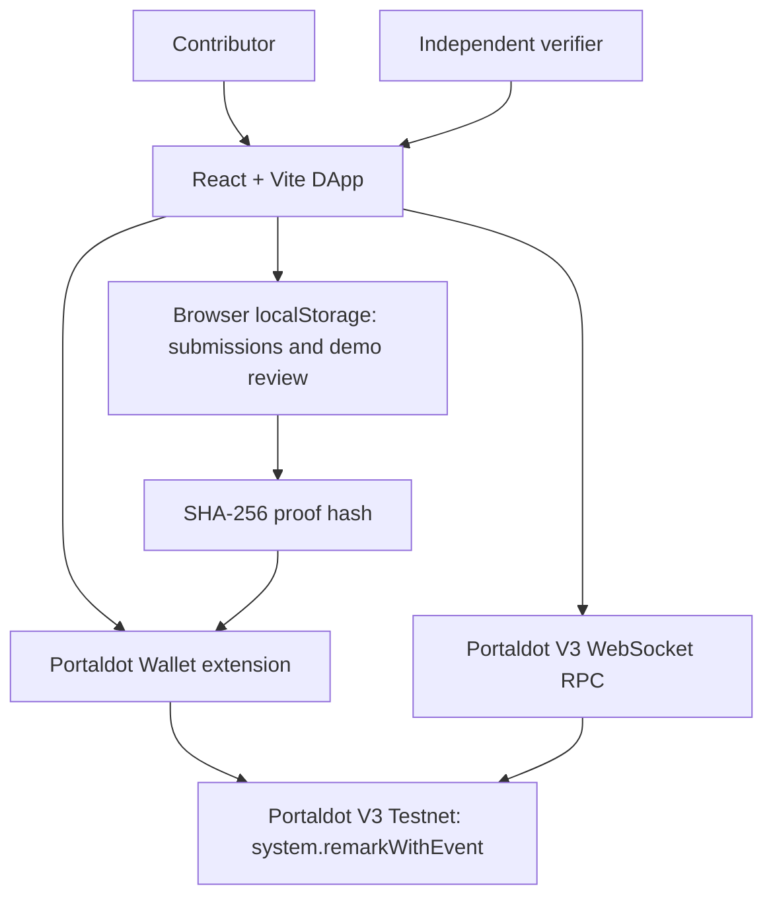

# Proof of Contribution (PoC)

**One Action. One Proof. Two Applications.**

A community-contribution proof-of-concept built for **Portaldot Hacker House 2026 — Track 4: Ecosystem DApps**. PoC lets contributors submit evidence, demonstrates a review process, publishes a SHA-256 proof hash on **Portaldot V3 Testnet**, and independently verifies the resulting transaction on-chain.

> **MVP status:** The contribution list and reviewer decisions currently use browser `localStorage` for demonstration. The published `system.remarkWithEvent` transaction and independent on-chain verification are real testnet interactions. This prototype does **not** enforce reviewer authorization on-chain or attest to the quality of a contribution.

## Live application

- **Public beta:** https://proof-of-contribution-eight.vercel.app
- **Source code:** https://github.com/Qnam309/proof-of-contribution
- **Network:** Portaldot V3 Testnet

Open the public beta and select **Launch App**. A Portaldot-compatible browser wallet extension is needed to submit under an address or publish a transaction. Reading an existing on-chain proof does not require a wallet or testnet tokens.

## Why Proof of Contribution?

Web3 communities create tutorials, open-source tools, translations, educational materials, and other useful contributions. Recognition can be difficult to verify or reuse outside the original platform. PoC explores a simple workflow where a contribution is backed by evidence and a publicly verifiable blockchain transaction.

## Key features

1. **Submit contribution** — Provide a title, category, description, and evidence URL. The initial record is saved locally in the browser.
2. **Demo review** — Approve or reject a locally saved submission. Currently, any connected wallet can use the demo reviewer controls; there is no secure reviewer role.
3. **Publish proof on-chain** — For an approved local record, compute a SHA-256 hash of canonicalized contribution fields and submit the hash using the Portaldot V3 `system.remarkWithEvent` extrinsic, signed through the browser wallet.
4. **Verify on-chain** — Read a block from the Portaldot V3 node; locate the transaction by hash; compare its remark with the supplied proof hash; and check the relevant `ExtrinsicSuccess` and `Remarked` events.
5. **Network view** — Read chain name, latest block at connection time, and a connected account's balance.
6. **Public-facing UI** — Landing page, **Launch App**, dashboard, proof management, and verification screens.

## Architecture



**Technology:** React, Vite, JavaScript, `@polkadot/api`, Portaldot injected wallet, `lucide-react`, and Vercel.

**Native-chain RPC:** `wss://test-node-v3.portaldot.dev`

## Verified testnet example

The MVP successfully submitted and verified the following proof on Portaldot V3 Testnet:

| Field | Value |
| --- | --- |
| Contribution | Portaldot V3 Beginner Guide |
| Chain | PortaldotV3 Test |
| Block number | `137579` |
| Extrinsic index | `1` |
| Transaction hash | `0x8e84f3871cf90ec6c98d87842ee46f618f4b86c37bbaf38a16e48c658394b27d` |
| Proof hash | `0x20ffba48d931940219c5ad726f2dac0487efbd6cd8d197396461a0411b56f116` |

The app reported **ON-CHAIN VERIFIED** after fetching the containing block and confirming the transaction, remark, and execution events. These values demonstrate that a transaction carrying the hash was included and executed successfully; they do **not** certify that a reviewer independently approved the content.

> **Browser-storage note:** Data created on `localhost:5173`, `localhost:5174`, and the Vercel deployment are stored separately. Existing on-chain transactions remain on the network regardless of browser storage.

## Run locally

### Prerequisites

- Node.js and npm
- A Chromium-based browser with a compatible Portaldot Wallet extension (for wallet interactions)
- Testnet tPOT only if submitting a signed transaction

### Setup

```bash
git clone https://github.com/Qnam309/proof-of-contribution.git
cd proof-of-contribution
npm install
npm run dev
```

On Windows PowerShell, if `npm` is blocked by the script execution policy, use `npm.cmd install` and `npm.cmd run dev` instead.

Open the **Local** URL shown by Vite in your terminal. Vite may choose port `5174` if `5173` is already in use. Authorize the correct local site in the wallet extension if needed.

### Production build

```bash
npm run build
npm run preview
```

## Demonstration flow

1. Open the application and connect the Portaldot wallet.
2. Submit a contribution with an evidence URL.
3. Open **Review** and approve it using the explicitly labeled demo reviewer controls.
4. Open **My Proofs** and choose **Publish Proof On-chain**. Review the estimated fee and wallet confirmation before signing.
5. After finalization, save the transaction hash, proof hash, and block hash.
6. Open **Verify**, provide those values, and run the on-chain check.

No transaction is required simply to view the application or verify an existing proof.

## Current limitations and roadmap

- **Local storage:** Contributions are not shared across users, browsers, or devices. A production system requires a shared indexed store or blockchain-native contribution registry.
- **Reviewer security:** Demo approval is not independently authenticated; a production version should enforce reviewer roles or decentralized governance on-chain.
- **Proof semantics:** A remark transaction commits to a hash, not a complete contribution record or a binding on-chain approval. Cross-application verification must also know the expected contribution data and hash format.
- **Indexing:** Current verification requires the transaction hash, proof hash, and block hash. Public lookup and proof sharing can be improved with an indexer or public verifier links.
- **UX and scalability:** Add accessible error handling, loading states, mobile refinements, and performance optimizations.

## Development log

- **MVP:** Built contribution submission, demo approval, native Portaldot wallet connection, live chain status, proof publication, and on-chain verification.
- **UI iteration:** Added public landing page, **Launch App**, a tabbed workspace, contribution statistics, and streamlined navigation.
- **Documentation:** Added project architecture, setup instructions, public beta link, verified transaction details, and transparent MVP limitations.

## Security

Never share your wallet recovery phrase or private key. The app requests wallet permissions and signed transactions through the browser wallet extension. Review all signing requests before approval. Testnet tokens have no intended monetary value.

## Hackathon

Built for **Portaldot Hacker House 2026**, Track 4 — Ecosystem DApps.

**Repository:** https://github.com/Qnam309/proof-of-contribution
