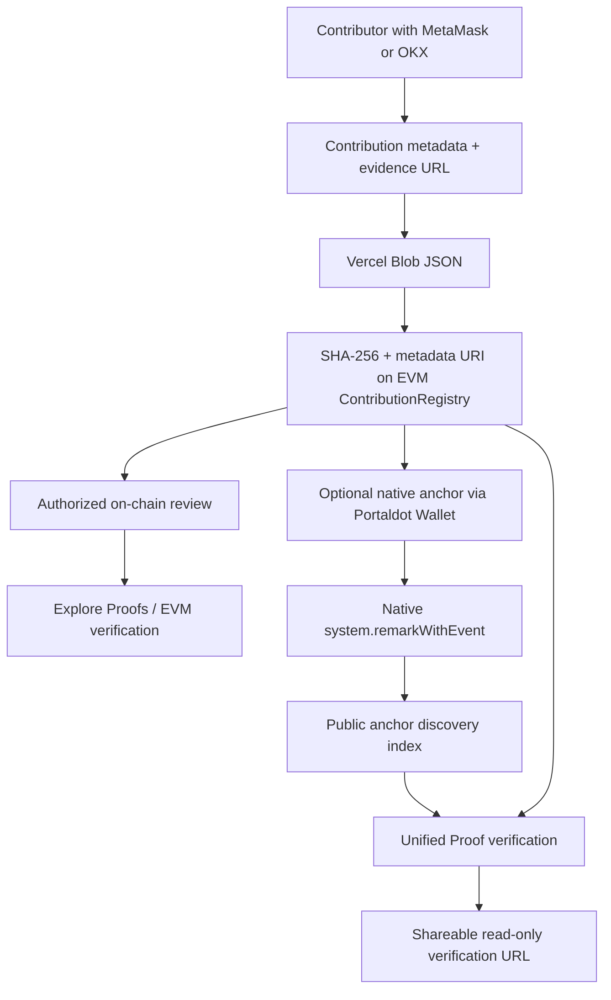

# PoC Ledger — Proof of Contribution

**One action. One proof. Independently verifiable on Portaldot V3.**

PoC Ledger is an open-source Web3 application for **submitting, reviewing, discovering, and verifying community contributions**. It combines a reviewer-controlled **EVM contribution registry** with optional **Portaldot Native proof anchoring**. Anyone can inspect a public contribution and independently check its blockchain evidence without connecting a wallet.

Built for **Portaldot Hacker House 2026 — Track 4: Ecosystem DApps**.

- **Live DApp:** https://pocledger.xyz/
- **GitHub:** https://github.com/Qnam309/proof-of-contribution
- **Network:** Portaldot V3 Testnet — EVM chain ID `420420777`
- **Deployed EVM contract (`ContributionRegistry`):** `0x2719e83b13f737a4f3988b7e13ef028e93bb1cb2`
- **Live EVM verification example:** https://pocledger.xyz/?contribution=2
- **Live unified verification example:** https://pocledger.xyz/?contribution=2&nativeTx=0xa69a10efa9d01c7490fb6f35b34138851d2f55e9a318daa78d1fa4bde826755b&nativeBlock=325447

> **Project status:** Deployed **testnet MVP**, not a mainnet production service. The EVM review and verification flow, a real native anchor, and public EVM + Native verification have been demonstrated on Portaldot V3 Testnet.

## Why this exists

Community contributions such as tutorials, code, testing, translations, research, and support often remain scattered across social channels. A link or screenshot alone is difficult to track, review, and verify later.

PoC Ledger provides a simple workflow: **submit evidence → review it → anchor an integrity hash → discover the record → independently verify and share it**.

The design distinguishes **human review** from **cryptographic integrity**. Blockchain verification establishes that the checked data matches the recorded hashes and transactions; it does **not** prove the underlying work was performed or that two wallet addresses have the same owner.

## Current capabilities

| Module | Function |
| --- | --- |
| **Wallets** | MetaMask and OKX Wallet for EVM actions; Portaldot Wallet for optional native anchoring |
| **Submit** | Upload contribution metadata (title, category, description, evidence URL) to Vercel Blob and register its URI and SHA-256 on EVM |
| **Review** | Authorized on-chain reviewers approve or reject contributions; rejection feedback is available in the contributor experience |
| **My Proofs / Explore Proofs** | View public EVM registry records, review status, evidence and integrity information |
| **EVM Registry Verify** | Fetch metadata, recompute SHA-256, and check the deployed contract's verification result |
| **Native Proof Verify** | Independently inspect a finalized native `system.remarkWithEvent` transaction and verify its proof hash; includes a real prefilled testnet example |
| **Unified Proof** | Match an EVM contribution's metadata SHA-256 to an actual Portaldot Native anchor, including transaction inclusion and finalization checks |
| **Public native anchor discovery** | Find indexed native anchor references through `/api/native-anchors`, and open or share a Unified Proof from Explore Proofs |
| **Shareable verification** | Contribution-specific links open the relevant verifier and automatically run read-only checks |
| **Admin** | On-chain reviewer authorization management; browser-tracked reviewer history is not a complete on-chain index |

The Native Proof verifier and optional Native Anchor are **not** a separate, fully reviewed Native Submit registry. Independent contribution submission/review using a native-only wallet remains future work.

## Architecture



### What is verified

**EVM Registry:** the verifier retrieves the registered metadata, computes the relevant hash, checks it against the value recorded in the EVM registry, and reads the contribution's review status. An **Approved** status represents an authorized review decision; it does not independently establish that evidence content is truthful.

**Native Proof:** the verifier checks a specified native extrinsic in a finalized block, its successful execution, and the expected `remarkWithEvent` proof hash.

**Unified Proof:** after reading both records, the verifier compares the **same metadata SHA-256** on EVM and Native. The public anchor index supplies **discovery hints**, not trusted verification results. Users' browsers recheck the blockchain data when opening shared links.

**Security boundary:** a matching hash is proof of consistency, **not** proof of a contribution's quality, originality, authorship, or ownership of both EVM and Native wallets. Native anchoring is optional and does not alter EVM review status.

## Reproducible live example — Contribution #2

| Field | Verified testnet example |
| --- | --- |
| Contribution | `#2` — **PoC Ledger Wallet Integration Testing** |
| Category | Development |
| Evidence URL | https://github.com/Qnam309/proof-of-contribution |
| EVM review status | **Approved** |
| Metadata SHA-256 | `0xabaec1d5aa5a84809f1efbfbfe880b4f0811ef38445688751e35523cab139ae1` |
| Native block / extrinsic | **#325447 / #1**, finalized |
| Native transaction | `0xa69a10efa9d01c7490fb6f35b34138851d2f55e9a318daa78d1fa4bde826755b` |
| Native block hash | `0x7f50dd8583ac7ea4d48449626c3b95f88529dcdb80ff2235f4478f58ceb107a9` |
| Native signer | `5FyMFb65KtEFXh9GGok5baHdLgxTVW4Bitr4oP2YJFqgNL3a` |

**Try it without a wallet:**

1. Open the [EVM verification link](https://pocledger.xyz/?contribution=2) to auto-load Contribution #2 and check the approved registry record and metadata integrity.
2. Open the [Unified Proof link](https://pocledger.xyz/?contribution=2&nativeTx=0xa69a10efa9d01c7490fb6f35b34138851d2f55e9a318daa78d1fa4bde826755b&nativeBlock=325447) to check the EVM metadata hash against the finalized Native transaction.
3. In the app, choose **Verify → Native Proof → Load Real Native Proof Example → Verify On-chain (free)** to inspect the native transaction independently.
4. Choose **Explore Proofs → Contribution #2** to inspect the public registry entry and use **Copy Unified Proof link** or **Open Unified Verify**.

Verification is read-only and does **not** spend tPOT. It requires the testnet RPC and external metadata endpoints to be reachable. Never repeat the native publish transaction just to verify this example.

### Earlier native experiment

A separate earlier Native `system.remarkWithEvent` proof was tested at block **#137579**, extrinsic **#1**, transaction `0x8e84f3871cf90ec6c98d87842ee46f618f4b86c37bbaf38a16e48c658394b27d`. It is distinct from Contribution #2's newer cross-environment anchor.

## Native anchor discovery

- After a native anchor is successfully verified, the app can register its public transaction reference through the serverless **`/api/native-anchors`** endpoint.
- The index stores discovery data in **Vercel Blob**, making known anchors discoverable beyond one browser's `localStorage`.
- **Explore Proofs** can display indexed native references and generate an EVM + Native verification link.
- **Unified Proof always checks the two environments again**; an indexed record alone is never sufficient to label a proof verified.

The tested public index includes Contribution #2. This is an MVP discovery mechanism, **not** a guarantee that every historical Native transaction has been indexed. Robust production-grade indexing, authorization/abuse protection and comprehensive chain scanning remain areas for further hardening.

## Stack and deployed network

- **Frontend:** React, Vite, JavaScript, CSS
- **EVM:** Portaldot V3 Testnet `ContributionRegistry`
- **Native:** Portaldot Native RPC, native wallet signing, `system.remarkWithEvent`
- **Metadata and anchor discovery:** Vercel Blob, Vercel Serverless Functions
- **Integrity:** SHA-256
- **Hosting:** Vercel
- **Optional community upload protections:** Upstash Redis, when the relevant upload mode is configured

| EVM network field | Value |
| --- | --- |
| Name | Portaldot V3 Testnet |
| Chain ID | `420420777` |
| RPC | `https://test-evm-rpc-v3.portaldot.dev` |
| Testnet token | POT / tPOT |
| Explorer | https://scanner-testnet-v3.portaldot.dev/ |

## Run locally

Requirements: Node.js, npm, and Vercel CLI access to the project for API-backed workflows. Wallet extensions are required **only** when signing transactions.

```bash
git clone https://github.com/Qnam309/proof-of-contribution.git
cd proof-of-contribution
npm install
```

For UI development:

```bash
npm run dev
```

For end-to-end testing with `/api` routes (metadata upload, rejection feedback, native anchor discovery):

```bash
npx vercel dev
```

On Windows PowerShell, use `npm.cmd` and `npx.cmd` if script execution policies prevent `npm`/`npx` from running. `npm run dev` by itself does not emulate Vercel serverless functions.

### Environment configuration

Configure required server-side environment variables in the Vercel project. Blob-backed uploads and native-anchor persistence require the appropriate **`BLOB_READ_WRITE_TOKEN`** and linked Blob Store. Consult [`UPLOAD_MODES.md`](./UPLOAD_MODES.md) for upload-mode settings and safeguards.

**Never commit** `.env.local`, `.vercel/`, wallet private keys, signing secrets, Blob tokens or Redis credentials. Do not enable unrestricted public uploads without tested server-side abuse protection.

### Transaction costs

| Operation | Testnet gas required? |
| --- | --- |
| Browse, search, copy links, EVM Verify, Native Verify, Unified Verify | **No** |
| Connect a wallet | **No** |
| Submit EVM contribution | **Yes** — contributor EVM wallet |
| Approve/reject or change reviewer access | **Yes** — authorized EVM wallet |
| Publish optional Native Anchor | **Yes** — Portaldot native wallet |
| Register/inspect an existing Native Anchor reference | **No blockchain transaction**; server API may have storage usage costs |

## Future development roadmap

The current release validates the core workflow on testnet. The next stages focus on turning a working proof-of-concept into infrastructure that other Web3 communities can adopt.

| Stage | Priority | Planned outcome |
| --- | --- | --- |
| **Phase 1 — Reliability** | Harden public indexing, upload abuse protection, RPC fallback and operational monitoring | More dependable verification and discovery as usage grows |
| **Phase 2 — Native participation** | Design native-wallet contribution submission, reviewer permissions and a consistent record model across execution environments | Members using Portaldot Native wallets can participate without requiring an EVM wallet |
| **Phase 3 — Ecosystem adoption** | Add evidence-URL search, portable contributor profiles and integration endpoints for community apps | External projects can discover verified records and build their own recognition workflows |

These are **planned capabilities, not features claimed to be live**. Each stage requires security review and real-network testing before wider release. Longer-term reputation signals should be grounded in reviewed records, rather than treating blockchain hashes as proof of contribution quality.

---

**Built for Portaldot Hacker House 2026 — Ecosystem DApps.**
